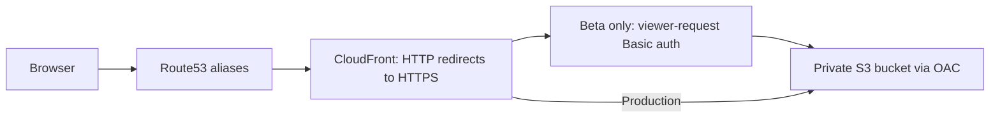
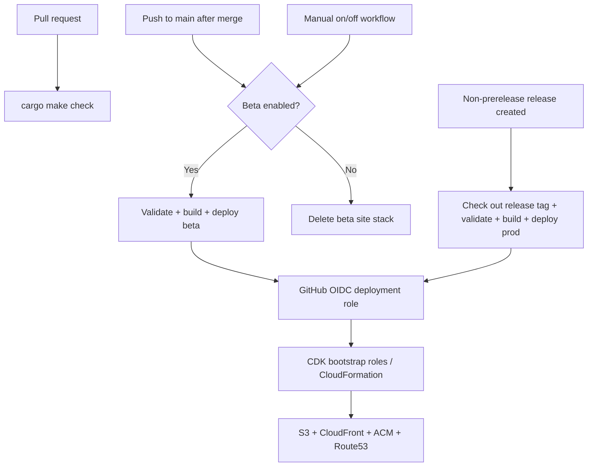

# Architecture

## Repository boundaries

`ui/` contains the standalone Rust/Dioxus crate, its toolchain, assets, and packaging
script. Its generated static site is `ui/dist/`. `cdk/` contains the CDK app, npm
dependencies, infrastructure tests, and deployment script; it consumes `ui/dist/`.
The root `Makefile.toml` coordinates both components. GitHub workflows, shared docs,
and agent skills remain at the repository root.

## Request path

Beta (`beta.linktree.polis.tv`) and production (`linktree.polis.tv`) have separate
CloudFormation stacks, buckets, certificates, and distributions. Both stacks live in
`us-east-1`, where CloudFront's ACM certificates must be provisioned. The existing
public Route53 hosted zone for `polis.tv` is imported by ID, avoiding account lookups
during CI. CDK creates A/AAAA aliases and DNS-validated certificates.

S3 website hosting is disabled. CloudFront uses Origin Access Control to read the
private bucket over HTTPS; public access is blocked and the bucket denies insecure
transport. CloudFront redirects HTTP requests to HTTPS and applies security response
headers. The hello-world site has one path, `/`; unknown paths are not rewritten to
`index.html`. Add an explicit routing policy when the UI needs client-side routes.

## Beta authentication

A CloudFront Function runs on **every viewer request**, including cached assets.
Missing or incorrect credentials receive a `401` with a Basic auth challenge. Valid
requests have their Authorization header removed before reaching S3.

GitHub repository secrets supply the beta username and password at synthesis time. Only
a SHA-256 digest of the expected Basic authorization header enters the function code.
The digest is still sensitive to offline password guessing: use a long, random password,
limit template access, and do not upload CDK assemblies as public artifacts. Credentials
are never bundled into the frontend. Rotate credentials by changing the beta secrets
and deploying again. Basic auth is a shared preview gate, not individual user identity.

## Delivery

CI needs no AWS credentials or beta secrets. Preview synthesis uses conspicuous dummy
configuration in separate output directories; deployment always synthesizes fresh with
required real settings. PR artifacts contain only the static site. Main pushes
reconcile the saved beta setting, so branch protection must require PRs if all
changes must be merged.
Production rebuilds the release tag with committed Cargo/npm lockfiles and pinned tools.
Deployments are serialized separately per environment and are not canceled mid-deployment.

The deployment script uses the GitHub role to upload files directly to S3, publishes
`index.html` last, and invalidates CloudFront. No deployment Lambda or runtime IAM role
is needed. Cache metadata requires revalidation; this favors correctness for the first scaffold. Old hashed assets are kept
for browsers with an older page open. Buckets are versioned. Production retains its
bucket and has stack termination protection. Disabling beta empties every object version and delete marker, then
deletes its site stack and bucket. Its bootstrap assets and IAM roles remain.
Cleanup of old assets while enabled, cache optimization, monitoring, and automated
rollback are later work.

## Permissions

`PolisLinktreePermissions` imports the existing GitHub OIDC provider and defines
`PolisLinktree-beta-github` and `PolisLinktree-prod-github`. Trust requires the exact
repository (`polis-interactive/linktree`) with GitHub's immutable owner/repository IDs
and STS audience. Beta additionally requires `refs/heads/main` and does not use a
GitHub Environment. Production requires the `prod` environment and its tag restrictions.

Every Linktree role has AWS-managed **ReadOnlyAccess** across the account. This is
intentional: the AWS console can list and inspect resources, including S3 buckets
and objects outside Linktree. Writes remain environment-specific. This policy also
allows reading data supported by ReadOnlyAccess; it is broader than metadata-only
console discovery. Existing resource-policy explicit denies still take precedence.
See [AWS's ReadOnlyAccess policy](https://docs.aws.amazon.com/aws-managed-policy/latest/reference/ReadOnlyAccess.html).

| Role | Write authority |
| --- | --- |
| GitHub role | Upload its site's objects, invalidate its distribution, assume its deploy/publishing roles; beta can also change its saved setting and delete its own site objects |
| CDK deployment role | Operate only `PolisLinktree-beta` or `PolisLinktree-prod`; pass only that stage's execution role to CloudFormation |
| CDK file-publishing role | Upload to its stage's CDK assets bucket |
| CloudFormation execution role | Manage its named site bucket, stage-tagged CloudFront distributions, fixed beta auth function, stack-owned ACM resources, and site DNS records; no IAM or Lambda writes; approved distribution tagging exception below |

`PolisLinktreeBootstrap-beta` (`polisltb`) and `PolisLinktreeBootstrap-prod`
(`polisltp`) are custom file-only bootstrap stacks. Each supplies the asset bucket,
deploy/publishing/execution roles, bootstrap-version parameter, and S3 origin access
control. The beta bootstrap also stores the enabled setting in SSM, initialized to false.
Workflow runs own its runtime value; unchanged bootstrap deployments leave it alone.
The site imports that OAC. Docker publishing is not supported. The synth
manifest requires bootstrap contract version 6 for deployment and 8 for lookups;
these stacks advertise version 8. Revisit that contract before adding CDK features.

Write scope uses exact bucket/stack ARNs. ACM lifecycle writes use AWS-owned
`aws:cloudformation:stack-name` tags; certificate requests are restricted to the
exact site domain without requiring tags to already exist. CloudFront's resource
schemas disable CloudFormation system tags, so distributions instead use
`polis:linktree-stage`; the beta auth function uses its exact ARN.

**Approved scope exception (2026-10-14):** creating a tagged distribution also requires
`cloudfront:TagResource`. The initial-tagging grant can label any existing
distribution in this account that lacks a Linktree stage tag, enabling subsequent
management of that distribution. It cannot relabel a distribution assigned to the
other stage, but it does not provide strict isolation from unrelated distributions.
The account owner explicitly approved this broader scope after automatic approval
review identified the risk.
See [CreateDistributionWithTags permissions](https://docs.aws.amazon.com/cloudfront/latest/APIReference/API_CreateDistributionWithTags.html).

Route53 changes allow
only A/AAAA aliases and CNAME validation records for that domain. Production has
an explicit deny for beta DNS names because IAM wildcard matching crosses labels.
See [CloudFormation resource tags](https://docs.aws.amazon.com/AWSCloudFormation/latest/TemplateReference/aws-properties-resource-tags.html).

The existing `CDKToolkit` bootstrap retains its administrator execution role for
privileged setup. Application workflows cannot assume its roles or modify the
permissions/bootstrap stacks. Changes to setup stacks require a privileged local
session. These deployment roles do not create a human console login or replace the
current local root session.

`cargo make permissions-verify` validates the deployed inline policies with IAM
Access Analyzer and checks account-wide console reads, permitted writes, and
cross-environment denials using IAM's simulator. Simulator results do not prove a
full service deployment: the first site deploy still needs live smoke checks.
