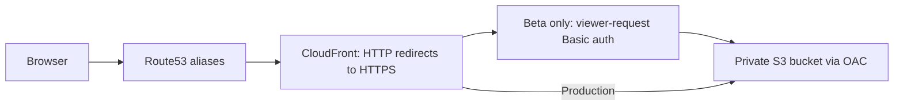
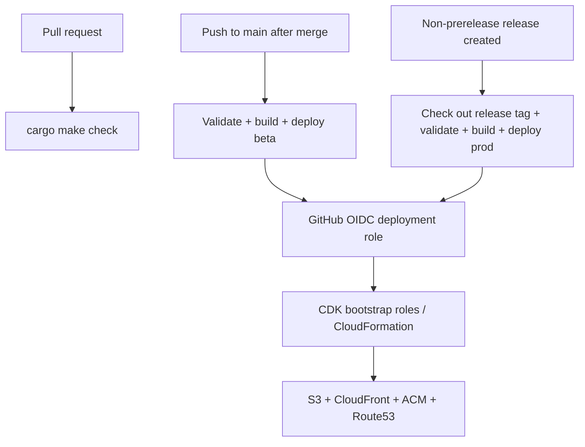

# Architecture

## Repository boundaries

`ui/` contains the standalone Rust/Dioxus crate, its toolchain, assets, and packaging
script. Its generated static site is `ui/dist/`. `cdk/` contains the CDK app, npm
dependencies, infrastructure tests, and deployment script; it consumes `ui/dist/`.
The root `Makefile.toml` coordinates both components. GitHub workflows, shared docs,
and agent skills remain at the repository root.

## Request path

Beta (`beta.linktree.polis.tv`) and production (`linktree.polis.tv`) have separate
CloudFormation stacks, buckets, certificates, and distributions. Both stacks live in
`us-east-1`, where CloudFront's ACM certificates must be provisioned. The existing
public Route53 hosted zone for `polis.tv` is imported by ID, avoiding account lookups
during CI. CDK creates A/AAAA aliases and DNS-validated certificates.

S3 website hosting is disabled. CloudFront uses Origin Access Control to read the
private bucket over HTTPS; public access is blocked and the bucket denies insecure
transport. CloudFront redirects HTTP requests to HTTPS and applies security response
headers. The hello-world site has one path, `/`; unknown paths are not rewritten to
`index.html`. Add an explicit routing policy when the UI needs client-side routes.

## Beta authentication

A CloudFront Function runs on **every viewer request**, including cached assets.
Missing or incorrect credentials receive a `401` with a Basic auth challenge. Valid
requests have their Authorization header removed before reaching S3.

GitHub environment secrets supply the username and password at synthesis time. Only
a SHA-256 digest of the expected Basic authorization header enters the function code.
The digest is still sensitive to offline password guessing: use a long, random password,
limit template access, and do not upload CDK assemblies as public artifacts. Credentials
are never bundled into the frontend. Rotate credentials by changing the beta secrets
and deploying again. Basic auth is a shared preview gate, not individual user identity.

## Delivery

CI needs no AWS credentials or beta secrets. Preview synthesis uses conspicuous dummy
configuration in separate output directories; deployment always synthesizes fresh with
required real settings. PR artifacts contain only the static site. Main pushes trigger
beta, so repository branch protection must require PRs if all changes must be merged.
Production rebuilds the release tag with committed Cargo/npm lockfiles and pinned tools.
Deployments are serialized separately per environment and are not canceled mid-deployment.

CDK's BucketDeployment uploads files and invalidates CloudFront. Cache metadata requires
revalidation; this favors correctness for the first scaffold. Old hashed assets are kept
for browsers with an older page open. Buckets are versioned and retained on stack deletion;
production also has stack termination protection. Asset cleanup, cache optimization,
monitoring, and automated rollback are later work.

## Permissions boundary

`PolisLinktreePermissions` creates/imports the account's GitHub OIDC provider and creates
two roles trusted only by this repository's `beta` and `prod` GitHub environments. These
roles can assume the named CDK bootstrap deploy, file-publishing, and lookup roles.
They do not receive static access keys or a direct AdministratorAccess policy.

**This is a bootstrap scaffold, not per-stack least privilege.** Both roles use the same
account/region CDK bootstrap roles and inherit the effective authority of their
CloudFormation execution policy. GitHub environment branch/tag restrictions are required.
Before production, choose a narrowly scoped execution policy and/or separate AWS accounts
or bootstrap qualifiers if beta must have no authority over production. The permissions
stack is deployed by a human bootstrap identity, never by application workflows.
